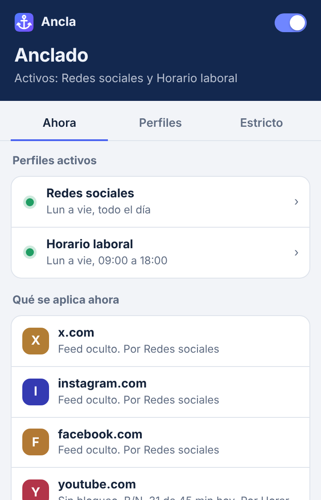
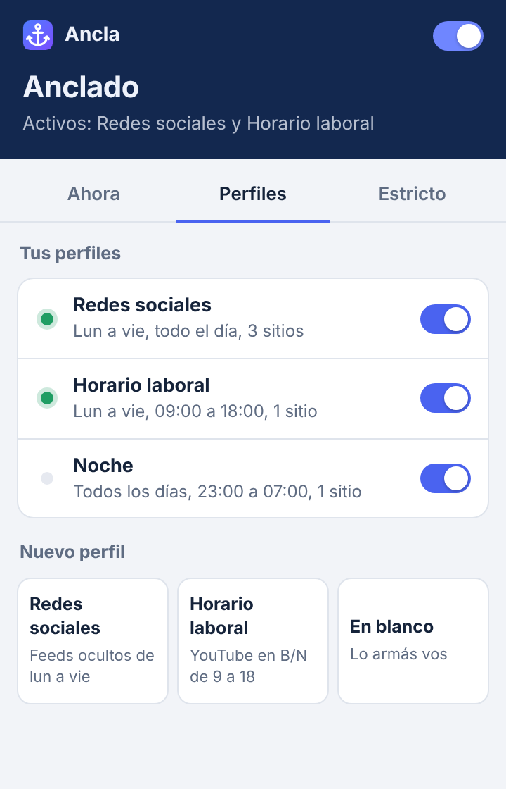
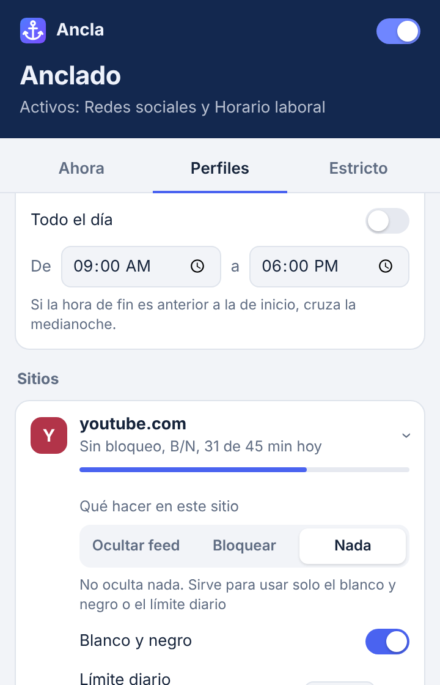

<p align="center">
  
</p>

<h1 align="center">Ancla</h1>

<p align="center">
  A Firefox extension that keeps you focused: hide social feeds, block distracting sites,<br>
  set daily time limits and turn sites grayscale — on your own schedule.
</p>

<p align="center">
  <a href="#english">English</a> · <a href="#español">Español</a>
</p>

<p align="center">
  
  &nbsp;
  
  &nbsp;
  
</p>

---

## English

### What it does

Ancla is organized in **profiles**. Each profile has a name, its own schedule (or "always"), a list of sites with rules, and an option to hide YouTube Shorts. Several profiles can be active at the same time and they combine: for each site the strictest rule wins.

For example:

| Profile | When | Rules |
|---|---|---|
| Social media | Mon–Fri, all day | X, Instagram and Facebook: hide feed |
| Work hours | Mon–Fri, 9:00–18:00 | YouTube: grayscale |

On weekends everything looks normal. On weekdays the feeds never show up, and YouTube is gray only during work hours.

**Per-site rules**

- **Hide feed** — the site keeps working for messages, search and profiles, without the infinite scroll. Supported on:
  - **X**: For you / Following, Explore and trends.
  - **Instagram**: feed and stories; Reels, Explore and stories redirect to home.
  - **YouTube**: home, recommendations and end screens.
  - **Facebook**: feed and stories; Watch and Reels redirect to home.
  - **Reddit**: front page, Popular and All.
- **Block** — a full-page block screen (for sites without feed support, like TikTok).
- **Grayscale** — removes color from the site.
- **Daily limit** — minutes per day. A notice appears with 5 minutes left; at the limit the site is blocked until tomorrow.

**Strict mode** (off by default): while any profile is active you can only make rules stricter. To loosen them you request an unlock and wait (10 minutes by default, with the tab open); then you get 5 minutes to make changes. With **progressive wait**, each unlock of the day doubles the wait.

### Install

- **From Firefox Add-ons:** _link coming soon_.
- **For development:** see [Development](#development).

### Privacy

Ancla does not collect or send any data. Settings and usage time are stored only in your browser. See [PRIVACY.md](PRIVACY.md).

### Development

Requirements: [Node.js](https://nodejs.org/) 20 or newer, and Firefox.

```bash
npm install
npm start        # opens Firefox with the extension loaded and live reload
npm test         # logic tests
npm run lint     # Mozilla's validator (web-ext lint)
npm run build    # creates the zip in dist/
```

You can also load it by hand: open `about:debugging#/runtime/this-firefox`, click **Load Temporary Add-on…** and pick `src/manifest.json`.

Project layout:

```
src/
  manifest.json   extension manifest
  common.js       data model, schedules, rule merging, strict mode (shared)
  background.js   settings migration and usage time tracking
  content.js      runs on every page: feeds, blocking, grayscale, Shorts, time counting
  popup.html/js   the panel
  unlock.html/js  the waiting tab for strict mode
  icons/
tests/            logic tests (node:test)
store/            Firefox Add-ons listing texts and screenshots
```

### Contributing

Sites change their HTML often, so the most useful contribution is keeping the feed selectors up to date. See [CONTRIBUTING.md](CONTRIBUTING.md).

### License

[MIT](LICENSE)

---

## Español

### Qué hace

Ancla se organiza en **perfiles**. Cada perfil tiene un nombre, su propio horario (o "siempre"), una lista de sitios con reglas y la opción de ocultar los Shorts de YouTube. Puede haber varios activos a la vez y se combinan: para cada sitio gana la regla más estricta.

Por ejemplo:

| Perfil | Cuándo | Reglas |
|---|---|---|
| Redes sociales | Lun a vie, todo el día | X, Instagram y Facebook: ocultar feed |
| Horario laboral | Lun a vie, 9:00 a 18:00 | YouTube: blanco y negro |

El fin de semana todo se ve normal. Entre semana los feeds nunca aparecen, y YouTube está gris solo en horario laboral.

**Reglas por sitio**

- **Ocultar feed**: el sitio sigue funcionando para mensajes, búsquedas y perfiles, pero sin el scroll infinito. Funciona en:
  - **X**: Para ti / Siguiendo, Explorar y tendencias.
  - **Instagram**: feed e historias; Reels, Explorar e historias redirigen al inicio.
  - **YouTube**: inicio, recomendados y pantallas finales.
  - **Facebook**: feed e historias; Watch y Reels redirigen al inicio.
  - **Reddit**: portada, Popular y All.
- **Bloquear**: pantalla de bloqueo en todo el sitio (para sitios sin feed compatible, como TikTok).
- **Blanco y negro**: le saca el color al sitio.
- **Límite diario**: minutos por día. Cuando quedan 5 minutos aparece un aviso, y al llegar al límite el sitio se bloquea hasta mañana.

**Modo estricto** (apagado por defecto): mientras haya algún perfil activo solo se pueden endurecer las reglas. Para aflojarlas hay que pedir un desbloqueo y esperar (10 minutos por defecto, con la pestaña abierta); después quedan 5 minutos para hacer cambios. Con la **espera progresiva**, cada desbloqueo del día duplica la espera.

### Instalar

- **Desde Complementos de Firefox:** _link próximamente_.
- **Para desarrollo:** ver [Desarrollo](#desarrollo).

### Privacidad

Ancla no recolecta ni envía ningún dato. La configuración y el tiempo de uso se guardan solo en tu navegador. Ver [PRIVACY.md](PRIVACY.md).

### Desarrollo

Requisitos: [Node.js](https://nodejs.org/) 20 o superior, y Firefox.

```bash
npm install
npm start        # abre Firefox con la extensión cargada y recarga automática
npm test         # tests de lógica
npm run lint     # validador de Mozilla (web-ext lint)
npm run build    # genera el zip en dist/
```

También podés cargarla a mano: abrí `about:debugging#/runtime/this-firefox`, tocá **Cargar complemento temporal…** y elegí `src/manifest.json`.

### Contribuir

Los sitios cambian su HTML seguido, así que la contribución más útil es mantener actualizados los selectores de los feeds. Ver [CONTRIBUTING.md](CONTRIBUTING.md).

### Licencia

[MIT](LICENSE)
